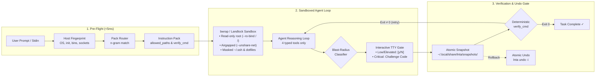

# LNTA — Linux Natural-Language Terminal Assistant

<p align="center">
  <a href="https://github.com/sm-me-dev/lnta/actions"></a>
  <a href="https://goreportcard.com/report/github.com/sm-me-dev/lnta"></a>
  <a href="https://img.shields.io/badge/Ubuntu%2024.04%2F26.04-AppArmor%20Ready-brightgreen?logo=ubuntu"></a>
  <a href="https://img.shields.io/badge/Go-1.23+-00ADD8?logo=go&logoColor=white"></a>
  <a href="LICENSE"></a>
</p>

<p align="center">
  <strong>Fast, kernel-sandboxed Linux terminal assistant in Go with deterministic verification gates and atomic rollbacks.</strong>
</p>

<p align="center">
  <a href="#60-second-quickstart"><strong>Quickstart</strong></a> •
  <a href="#daily-workflows"><strong>Daily Workflows</strong></a> •
  <a href="#how-it-works"><strong>Architecture</strong></a> •
  <a href="docs/SECURITY_MODEL.md"><strong>Security</strong></a> •
  <a href="#documentation-suite"><strong>Docs</strong></a>
</p>

---

## The Problem & Solution in 3 Bullet Points

Giving an LLM raw `/bin/bash` access is an invitation to accidental data loss, credential theft, or stealth persistence. **LNTA solves this natively:**

- 🛡️ **Airgapped `bwrap` & Landlock Sandbox**: Raw shell agents can `rm -rf /` or leak your `~/.ssh` and `.env` files via prompt injection. LNTA conducts all context discovery inside an airgapped kernel sandbox with a read-only root (`--ro-bind / /`), disconnected networking (`--unshare-net`), masked credentials, and phantom dotfile lockouts (defending against **CVE-2026-25725**).
- 🎯 **Deterministic Verification Gates**: Unbounded agents self-report success even when commands fail or leave daemons broken. LNTA enforces automated, deterministic verification checks (`verify_cmd` using `systemd-analyze`, `desktop-file-validate`, `ufw status`). The task **cannot exit with success** until the actual Linux validation tool exits `0`.
- ⏪ **Instant Atomic Rollback**: When other tools break a configuration file, recovery means tedious manual hunting through shell history. Every file write in LNTA creates an atomic snapshot under `~/.local/share/lnta/snapshots/`. Restore the machine to its exact previous state in <1s with `lnta undo` or browse past changes visually via `lnta sessions`.

---

## 60-Second Quickstart

### 1. One-Line Install

```bash
# Detects distribution (deb/rpm/arch/tarball), verifies SHA-256, and installs cleanly
curl -fsSL https://raw.githubusercontent.com/sm-me-dev/lnta/main/scripts/install.sh | bash
```

### 2. Shell Integration

Add LNTA to your shell profile to activate `lnta fix` and the `Ctrl+G` line-editor hotkey:

```bash
# For Zsh (~/.zshrc)
eval "$(lnta init zsh)"

# For Bash (~/.bashrc)
eval "$(lnta init bash)"

# For Fish (~/.config/fish/config.fish)
lnta init fish | source
```

Set your preferred OpenAI-compatible API key or use [local Ollama](#local-offline-mode):

```bash
export LNTA_API_KEY="sk-..."
```

---

<a id="daily-workflows"></a>
### 3. Four Immediately Useful Real-World Commands (Daily Workflows)

#### 1. One-Shot System Task (`lnta "..."`)
Create a validated Freedesktop `.desktop` launcher without memorizing syntax:

```bash
lnta "create a desktop launcher for my backup utility at ~/bin/backup-sync"
```

```text
## System Context
- os: ubuntu 26.04 (Ubuntu 26.04 LTS) • shell: /usr/bin/zsh • binaries: bwrap ✓, desktop-file-validate ✓

## Matched Pack (1)
- Linux Desktop Entries (linux-desktop-entries)
  allowed_paths: [~/.local/share/applications/*.desktop]
  verify_cmd: desktop-file-validate "${target}"

[write_scoped_file] ~/.local/share/applications/backup-sync.desktop (created, 218B)
[complete_task] Verification passed: desktop-file-validate exit 0.
```

#### 2. Pipe & Fix Failed Logs (`journalctl -xe | lnta fix`)
Pipe failing service logs directly into LNTA for diagnosis and remediation:

```bash
journalctl -u nginx -n 30 --no-pager | lnta "diagnose and fix the crash"
```

```text
Found syntax error in /etc/nginx/sites-enabled/default at line 42 (missing semicolon).
? Propose fix to /etc/nginx/sites-enabled/default [y/N]: y
[complete_task] nginx -t verification passed.
```

#### 3. Interactive Visual Undo (`lnta undo -i`)
Launch the Time Machine TUI to browse file diffs and roll back past runs:

```bash
lnta undo -i
```

```text
┌─ Past Runs ─────────────────────────┐┌─ Run Details: 20261024-101502 ─────────────────┐
│ [OK]   create backup-sync.desktop   ││ Status:   Verified (PASS)                      │
│ [FAIL] open port 443 in ufw         ││ Pack:     linux-desktop-entries                │
│ [UNDO] bad sync timer               ││ File:     ~/.local/share/applications/         │
│                                     ││           backup-sync.desktop                  │
└─────────────────────────────────────┘└────────────────────────────────────────────────┘
  ↑/↓: Select  •  Enter/u: Rollback  •  Tab: Switch Pane  •  q: Quit
```

#### 4. Safe Remote SSH Management (`lnta --ssh user@host "..."`)
Execute tasks on remote servers with preflight fingerprinting and local approvals:

```bash
lnta --ssh user@prod-web-01 "allow wireguard on udp 51820 in ufw and verify"
```

```text
Connected to user@prod-web-01 (Ubuntu 24.04 LTS)
Preflight: ufw ✓, ss ✓
? [prod-web-01] Execute mutation: ufw allow 51820/udp (elevated risk) [y/N]: y
[complete_task] Remote verification passed.
```

---

## How It Works

LNTA implements a strict, unidirectional pipeline where LLM execution is bounded at every stage:

### System Architecture Diagram



---

## Technical Comparison

An honest assessment of how LNTA compares to raw shell wrappers and heavyweight autonomous coding agents:

| Feature | Raw Shell Wrappers (`sgpt`) | Heavy Coding Daemons (`Claude Code`, `OpenCode`) | LNTA |
|---|---|---|---|
| **Inspection Sandbox** | ❌ None (raw host bash) | ⚠️ Partial / Docker optional | ✅ **Dual-tier kernel sandbox** (`bwrap` + Landlock) |
| **Network Egress During Discovery** | ❌ Unrestricted | ❌ Unrestricted | ✅ **Isolated** (`--unshare-net` loopback only) |
| **Secret Masking** | ❌ None (`~/.ssh` exposed) | ⚠️ Partial `.env` ignores | ✅ **Full masking** (`~/.ssh`, `~/.gnupg`, `~/.aws`, `.env*`, AF_UNIX sockets) |
| **Phantom Dotfile Defense (CVE-2026-25725)** | ❌ Vulnerable | ❌ Vulnerable | ✅ **Mitigated** (all startup dotfiles mapped to `/dev/null`) |
| **Approval Mechanism** | ⚠️ Generic prompt | ⚠️ Blanket bypass flags | ✅ **3-Tier Blast-Radius Classifier** + Anti-Fatigue Challenge Gate |
| **Verification Authority** | ❌ LLM self-reports | ⚠️ LLM self-reports | ✅ **Deterministic shell gate** (`verify_cmd` exit code 0 mandatory) |
| **Rollback Capability** | ❌ None | ⚠️ Git only | ✅ **System-wide atomic snapshots** (`lnta undo`, `lnta sessions`) |
| **Latency to First Token** | ~500ms | 3–10 seconds (daemon load) | ✅ **< 5ms** local fingerprint + pack routing |
| **Interactive Hotkey** | ❌ Shell wrapper | ❌ Full terminal hijack | ✅ **In-line `Ctrl+G`** via native shell line editor |
| **Local Offline LLMs** | ⚠️ Manual URL flag | ⚠️ Remote focused | ✅ **Auto-discovery** (`lnta --local` via Ollama) |
| **Remote SSH Execution** | ❌ Run locally only | ❌ Requires remote daemon | ✅ **Native `--ssh`** with local approval attribution |

---

## Documentation Suite

Dive deeper into LNTA's architecture, security controls, and extensibility:

- 📖 **[User Guide (`docs/USER_GUIDE.md`)](docs/USER_GUIDE.md)**: Detailed workflows for all 8 interaction modes, shell widgets, multi-turn chat, and full configuration templates for OpenRouter, Anthropic, OpenAI, Gemini, and Ollama.
- 🔒 **[Security Model (`docs/SECURITY_MODEL.md`)](docs/SECURITY_MODEL.md)**: Deep dive into the 2-tier sandbox, Unix socket isolation, CVE-2026-25725 defenses, blast-radius heuristics, and AppArmor troubleshooting.
- 📦 **[Pack Authoring Guide (`docs/PACK_AUTHORING.md`)](docs/PACK_AUTHORING.md)**: 5-minute tutorial on writing custom `.md` Instruction Packs, frontmatter reference, and static verification with `lnta packs validate`.
- 🛠️ **[Contributing Guide (`CONTRIBUTING.md`)](CONTRIBUTING.md)**: Development setup, adding new distro rules, and running the `cmd/lnta-eval` automated benchmark suite.
- 🛡️ **[Security Policy (`SECURITY.md`)](SECURITY.md)**: Vulnerability disclosure policies, response times, and architectural security invariants.

---

## Key Features

- **Blazing Fast Preflight**: Local system fingerprinting and n-gram pack routing complete in **under 5 milliseconds**.
- **Unix Pipeline Friendly**: Preserves the first 16KB and last 48KB of piped context while redirecting approval prompts to `/dev/tty`.
- **Command-Line Hotkey (`Ctrl+G`)**: Replaces natural language with verified commands directly in your Zsh, Bash, or Fish buffer.
- **Explain Mode (`--explain`)**: Physically strips mutation tools from the agent's capability manifest for 100% read-only diagnostic reasoning.
- **Dry-Run Preview (`--dry-run`)**: Generates unified color diffs and commands without touching the disk or executing mutations.
- **Time Machine TUI (`lnta sessions`)**: Two-pane BubbleTea browser with fuzzy searching, run diff inspection, and single-keystroke rollbacks.
- **100% Offline Ollama Execution (`--local`)**: Discovers local models at `127.0.0.1:11434` and runs zero-egress tasks without an API key.

---

## Installation Packages & Options

### Option 1: Official Signed APT Repository (Ubuntu / Debian — Recommended)

Install LNTA with automatic security updates via standard `apt upgrade`, hosted at zero cost on GitHub Pages:

```bash
curl -fsSL https://sm-me-dev.github.io/lnta/install-apt.sh | sudo sh
```

<details>
<summary><strong>Manual APT Keyring & Sources Setup (Step-by-Step)</strong></summary>

For security-conscious sysadmins who prefer inspecting commands rather than piping curl to sh:

```bash
# 1. Install the dedicated LNTA Ed25519 repository signing key
sudo install -m 0755 -d /etc/apt/keyrings
curl -fsSL https://sm-me-dev.github.io/lnta/lnta-archive-keyring.asc | sudo gpg --dearmor -o /etc/apt/keyrings/lnta.gpg
sudo chmod a+r /etc/apt/keyrings/lnta.gpg

# 2. Add the modern DEB822 repository entry
echo "deb [arch=$(dpkg --print-architecture) signed-by=/etc/apt/keyrings/lnta.gpg] https://sm-me-dev.github.io/lnta stable main" | \
  sudo tee /etc/apt/sources.list.d/lnta.list > /dev/null

# 3. Install LNTA
sudo apt update && sudo apt install -y lnta
```
</details>

---

### Option 2: Homebrew / Linuxbrew Tap (macOS & Linux)

For developers using [Homebrew on Linux](https://docs.brew.sh/Homebrew-on-Linux):

```bash
brew tap sm-me-dev/lnta https://github.com/sm-me-dev/lnta
brew install lnta
```

---

### Option 3: Universal Standalone Installer (All Linux Distributions)

Auto-detects your distribution, fetches the latest package or static binary, verifies SHA-256 signatures, and installs:

```bash
curl -fsSL https://raw.githubusercontent.com/sm-me-dev/lnta/main/scripts/install.sh | sudo bash
```

#### Direct Package Downloads

| Distribution | Architecture | Installation Command |
|---|---|---|
| **Ubuntu / Debian** | `amd64` / `arm64` | `curl -fsSL https://github.com/sm-me-dev/lnta/releases/latest/download/lnta_0.1.0_linux_amd64.deb -o lnta.deb && sudo dpkg -i lnta.deb` |
| **Fedora / RHEL / openSUSE** | `x86_64` / `aarch64` | `curl -fsSL https://github.com/sm-me-dev/lnta/releases/latest/download/lnta-0.1.0-1.x86_64.rpm -o lnta.rpm && sudo rpm -i lnta.rpm` |
| **Arch Linux / Manjaro** | `x86_64` | `curl -fsSL https://github.com/sm-me-dev/lnta/releases/latest/download/lnta-0.1.0-1-x86_64.pkg.tar.zst -o lnta.pkg.tar.zst && sudo pacman -U --noconfirm lnta.pkg.tar.zst` |
| **Static Tarball (Any Linux)**| `amd64` / `arm64` | `curl -fsSL https://github.com/sm-me-dev/lnta/releases/latest/download/lnta_0.1.0_linux_amd64.tar.gz \| tar -xz && sudo mv lnta /usr/local/bin/` |

---

### Option 4: Building from Source & Go Install

```bash
# Using go install
go install github.com/sm-me-dev/lnta/cmd/lnta@latest

# Or building from git repository
git clone https://github.com/sm-me-dev/lnta.git
cd lnta
go build -o lnta ./cmd/lnta
sudo mv lnta /usr/local/bin/
```

---

### In-Place Upgrades (`lnta self-update`)

Standalone binary installations can upgrade themselves directly:

```bash
# Check if an update is available
lnta self-update --check

# Upgrade binary in-place with SHA-256 verification
lnta self-update
```

*(Note: If LNTA was installed via APT, RPM, or Pacman, `lnta self-update` automatically detects your package manager and advises using `sudo apt update && sudo apt upgrade lnta` to preserve system integrity).*

---

## Diagnostics & AppArmor Setup

Verify your installation and kernel sandboxing capabilities with `lnta doctor`:

```bash
lnta doctor
```

```text
## LNTA Doctor Diagnostics
- LLM API Config:        OK
- LLM API Connectivity:  OK
- bwrap binary:          /usr/bin/bwrap
- AppArmor userns:       OK
- Landlock LSM:          available
- System Validators:     desktop-file-validate ✓, systemctl ✓, ss ✓, ufw ✓
All checks passed
```

### Ubuntu 24.04 / 26.04 AppArmor Note
On Ubuntu 24.04 and 26.04 LTS, unprivileged user namespaces are restricted by default. If `lnta doctor` reports that `bwrap` is blocked, generate and load the AppArmor profile:

```bash
lnta doctor --generate-apparmor | sudo tee /etc/apparmor.d/bwrap
sudo apparmor_parser -r /etc/apparmor.d/bwrap
```

*(Note: The official `.deb` package installs this profile automatically during package setup).*

---

## License

LNTA is open-source software released under the [MIT License](LICENSE).
